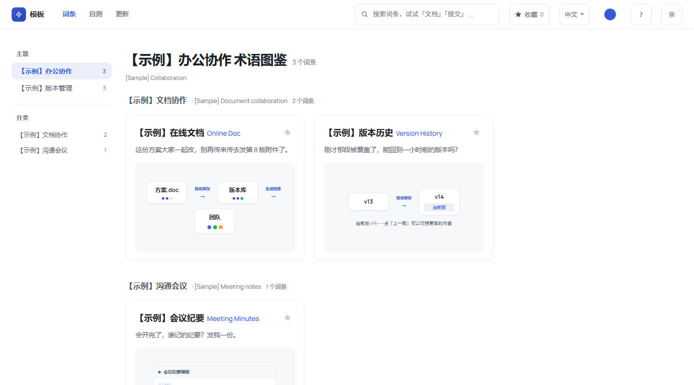

# 词条图鉴模板 glossary-atlas-template

**单文件、零外部请求的图鉴引擎 + 内容 / 工程双线骨架。** 拿它派生一个新主题的「术语图鉴」：内容线只写 Markdown，工程线一条命令出成品。

> ⚠️ **本仓库是模板骨架，不是可运行成品**：不含任何内容数据，因此 clone 后直接构建会报错——这是预期状态，跑一次下节的「起步」即可。
> 本地文件夹名用中文「词条图鉴模板」，仓库名用英文 `glossary-atlas-template`，两者是同一份东西。

Node.js（实测 v24）· 零 npm 依赖 · [MIT](LICENSE)



<sub>示例站点：跑完下面的「起步」，再写几条自己的卡片就是这个样子（图为演示数据，本仓库不含内容数据）。</sub>

## 快速开始

**人类**：在 GitHub 页面点 **Use this template → Create a new repository**，得到属于你自己的新仓库。
**Agent / 命令行**：直接 clone（模板仓库没有你需要继承的提交历史）。

```bash
git clone https://github.com/Columbinagi/glossary-atlas-template.git 我的图鉴
cd 我的图鉴
node engineering/起步.mjs      # 一条命令：建骨架 → 拼合 → 校验，期望看到「校验全部通过」
node engineering/预览服务.mjs   # 本地预览 http://localhost:8123/
```

`起步.mjs` 做四件事（已存在的文件一律跳过，可反复运行）：建 `dist/`、写一张示例卡片、建 `content/词条清单.md`、建 `content/更新日志.md`；随后自动跑拼合与校验。跑通后站点产出在 `dist/`，用浏览器打开即见效果。

**接下来**：改 `content/站点配置.js`（品牌名、主题、分类）→ 把示例卡片换成你自己的内容 → 照「怎么用它派生」第 2 条改掉校验里的搜索探针。行号与改法见 [docs/派生与排错.md](docs/派生与排错.md)。

## 派生拿什么 / 不拿什么

| 拿 | 不拿 |
|---|---|
| `templates/`（引擎母版） | 本仓库的 `content/` 示例数据（派生时换成你自己的） |
| `engineering/`（8 个脚本） | 本仓库的 7 份管理文档（`AGENTS.md` `MEMORY.md` `PRD.md` `ROADMAP.md` `ACCEPTANCE.md` `SOUL.md` `USER.md`） |
| `skills/`（两个技能） | 本仓库的 git 历史、`logs/`、`notes/` |
| `CONTRACT.md` `.gitignore` `.gitattributes` | — |

**最小阅读集**：`README.md`（本篇）→ [docs/派生与排错.md](docs/派生与排错.md)（接线点与排错）→ `CONTRACT.md`（字段契约）。
本项目自己的目录全图、产物顺序与归档决策树见 `AGENTS.md` §二 / §三 / §五；当前状态与发布记录见 `ROADMAP.md` §三。

> ⚠️ **本仓库既是骨架母版，也是一个在跑的项目**：上面 7 份根目录文档（`AGENTS.md` `MEMORY.md` `PRD.md` `ROADMAP.md` `ACCEPTANCE.md` `SOUL.md` `USER.md`）
> 是**本项目自己怎么干活**的规矩。**`Use this template` / clone 会把它们一起带过去** —— 派生后请**删掉或改写成你自己的**
> （它们写的是"词条图鉴模板"这个项目，留着会让你的 Agent 读到别人的规矩）。
> 派生真正要的是：`templates/` `engineering/` `skills/` `CONTRACT.md` `.gitignore` `.gitattributes` ＋ `content/` 骨架。
> 派生流程与必改项见 [docs/派生与排错.md](docs/派生与排错.md)。

## 怎么用它派生

必改 6 处，每条的**行号、代码改法、排错**见 [docs/派生与排错.md](docs/派生与排错.md)。
真正挡住第一跑的只有第 2 条（起步脚本放的示例卡片正好绕过它）；第 1 条三处硬编码同值、不报错，属命名一致性缺陷；第 3 条在你写出新术语缺字时才红；第 6 条只影响你的 Agent 读到哪套规矩。

1. **产物文件名写死在 3 个脚本里**（`拼合.mjs` 的 `const OUT`、`校验.mjs` 的 `const OUT`、`预览服务.mjs` 的 `HOME_FILES`；v1.1.5 时分别在 `:17` / `:21` / `:33`，**v2.1.0 时 `:19` / `:21` / `:33`**）→ 三处同值所以不报错，但改了品牌名后产物名不会跟着走；建议改成由 `SITE_META.brandName` 推导。
2. **校验的搜索探针写死**（`校验.mjs` 的 `const probes`，v1.1.5 时 `:318`；`#topic=t5` 在 `:320-321`）→ 换成你首条词条的名字与拼音首字母串，否则固定 2 条红、退出码 1。
3. **引擎的 PYI 拼音表只覆盖源内容用字**（母版里的 `var PYI`，v1.1.3 时在 `:3086`；v1.1.5 时在 `:3137`；**v2.1.0 时在 `:3277`**；**行号会随母版增行漂移，搜 `var PYI` 最稳**）→ 校验会点名缺哪些字，按提示补齐。
4. **品牌名与产物名散落在 7 个文件、12 行里** → 完整清单见 docs。
5. **`内容规范.md` 与 `skills/` 的正文**是按源项目写的 → 结构可沿用，举例的术语、主题名、行业名要换成你的。
6. **本仓库的 7 份管理文档要删掉或改写**（`AGENTS.md` `MEMORY.md` `PRD.md` `ROADMAP.md` `ACCEPTANCE.md` `SOUL.md` `USER.md`）→ 它们写的是"词条图鉴模板"这个项目自己怎么干活，`Use this template` 会把它们一起带过去；不处理的话，你的 Agent 每次会话自动加载的是**别人的规矩**。要么删，要么照它们把内容换成你自己的（推荐后者 —— 这套骨架文档本身就是给你省事的）。

派生完成后，在自己的 README 或 `CONTRACT.md` 里记一行「派生自 glossary-atlas-template v2.0.0（commit &lt;短哈希&gt;）」，将来模板升级才追得回差异。

### 骨架的权威在哪（已经派生过就看这里）

- **本仓库是骨架的权威来源**：引擎母版（`templates/`）与工程线脚本（`engineering/`）的改动**先在本仓库落地**，记进 [CHANGELOG.md](CHANGELOG.md) 的「骨架变更」，再向外分发。
- **派生项目是消费者**：按 CHANGELOG 的骨架变更逐条对照同步，**只改骨架，不要覆盖你的 `content/`**。
- **反向纪律**：如果你在自己的活动项目里改了骨架（真实内容在那边，很多问题只有它跑得出来），**当天把它搬回本仓库**并记一行——否则两边会分叉。
- **为什么写这条**：v1.1.2 的顶栏修复与另一个项目的拼音补字，正是「两边各改一行、互不知情」造成的分叉：模板缺拼音、项目缺修复。同步一次的成本远低于"谁都以为自己是最新"。

比对两边是否已经分叉，最快是比哈希（各自的仓库里各跑一次，看输出是否相同）：

```bash
git hash-object templates/词条图鉴模板-v6.html
```

改完样式之后，跑一次 `node engineering/体检.mjs`（详见 [docs/派生与排错.md](docs/派生与排错.md) 第四节）——窄屏问题只有扫过才知道。

## 环境要求

- **Node.js**：唯一硬依赖，零第三方包（没有 `package.json`，不需要 `npm install`）。
- **无头 Chrome（可选）**：`校验.mjs` 的 Chrome 路径默认写死 Windows 的安装位置（**可用 `JC_CHROME` 覆盖**），用来自检站点的 `#debug`、搜索语料与**十一条行为断言**（③-c 自测进度 / ③-d 返回列表 morph / ③-e 页面级状态残留 / ③-f 放大态残留 / ③-g 返回来源 / ③-h 跨词条过渡 / ③-i 分类高亮跟随 / ③-j 导航收起浮层 / ③-k 切语言保留内容位置 / ③-l 无障碍跳转链接与焦点环 / ③-m 严格模式退出码）。没有它（或装在别处）时这几项会打印「⏸ 需外部验证」并单独计数，**不计入失败**；要自动化就把默认路径改对，或设 `JC_CHROME`。
  ⚠️ 由此带来一个判定盲区：**退出码 0 并不总等于站点自检真的过了**——在没装 Chrome 的机器上，同一份代码会得到相反的通过口径（独立测试实测）。**想要「退出码 0 就等于真检过」就加 `--strict`**（或 `JC_STRICT=1`）：此时任何「⏸ 需外部验证」的项都会让退出码变成 **2**（区别于硬失败的 1），并打印一行「严格模式：N 项未在本机验证」；**默认行为不变**，CI（ubuntu 无 Chrome）照旧全绿。
  · **想分小批跑**（本命令一次会起十几个无头 Chrome）：`JC_SKIP=③-c,③-k node engineering/校验.mjs` 跳过指定项 —— 被跳过的项按 ⏸ 计数，`--strict` 照样会拦。
- 浏览器：任意现代浏览器。站点是单文件，双击 `dist/<产物名>.html` 即可打开。

## 版本与来源

- **当前版本**：`v2.1.0`（2026-10-31，**本地候选，待发布**；线上最新仍为 `v2.0.0`）—— 逐版变更见 [CHANGELOG.md](CHANGELOG.md)，可下载的历史版本见 [Releases](https://github.com/Columbinagi/glossary-atlas-template/releases)。
- **怎么更新到新版**：模板是「拷骨架」而不是「装依赖」——把 `templates/`、`engineering/`、`skills/`、`CONTRACT.md`、`.gitattributes`、`.gitignore` 与新版逐个对比后自行合并，**不要覆盖你的 `content/`**；行号与改法见 [docs/派生与排错.md](docs/派生与排错.md)。
- **来源**：骨架**原先** 14 个文件自一个已在运行的图鉴项目抽出，源提交 `af88476`；**v2.0.0 起新增 `templates/词条图鉴模板-v6.html`（默认引擎）**。**v2.1.0 把这套引擎整体收编自一个已上线案例项目**——母版 / `校验.mjs` / `拼合.mjs` 三件逐字节对齐，来源与影响面见 [CHANGELOG.md](CHANGELOG.md) v2.1.0 段。v1.x 的 `templates/词条图鉴模板-v5.html` 已**退役删除**（Git 历史可恢复：`git show v2.0.0:templates/词条图鉴模板-v5.html`）。
  - **「14 个」的口径**：指 `.github/workflows/smoke.yml` 里那份骨架清单（14 个文件，**不含** `README.md` / `LICENSE` / `CHANGELOG.md`，也不含 `AGENTS.md` `PRD.md` 等 7 份项目文档——那 7 份是**本项目自己怎么干活**的规矩，派生时不用搬）。母版只有 `templates/词条图鉴模板-v6.html` 一份。
  - **未含**该项目任何内容数据、进度文档与产物；文件注释里留有指向源项目内部文档的悬空引用，清单同见 [docs/派生与排错.md](docs/派生与排错.md) 第三节。
- **派生时请在自己项目里记一行**「派生自 glossary-atlas-template v2.0.0（commit &lt;短哈希&gt;）」—— 将来模板升级，这条记录是唯一能对齐差异的线索。

## 规矩在哪（**本文不抄**）

> **本项目怎么干活**（目录结构、产物落点、命名规则、工作流、维护义务）**只有一处正文：`AGENTS.md`** —— 新会话按 `AGENTS.md` §零 的最小集开场先读它。
> 需求基准在 `PRD.md`，线间契约在 `CONTRACT.md`，进度在 `MEMORY.md` / `ROADMAP.md`。
> **本文只回答四件事**：这是什么 ／ 怎么装 ／ 怎么用 ／ 现在什么版本。规矩抄一份过来就是「第二处正文」—— 两处必然各自漂移。
> **派生项目请把本文与 7 份治理文档删改重写**：它们写的是「本项目自己怎么干活」，不是骨架的一部分。

## 许可证

[MIT](LICENSE) © 2026 凪の海 (Columbinagi) —— 随便用、随便改、随便再分发，保留版权声明即可。
